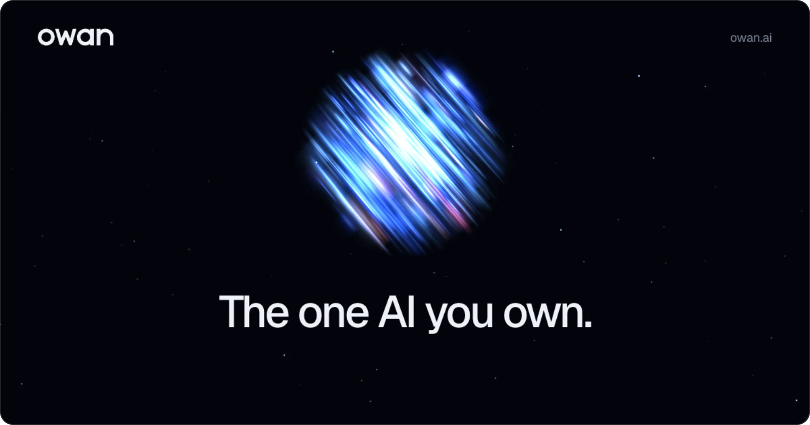
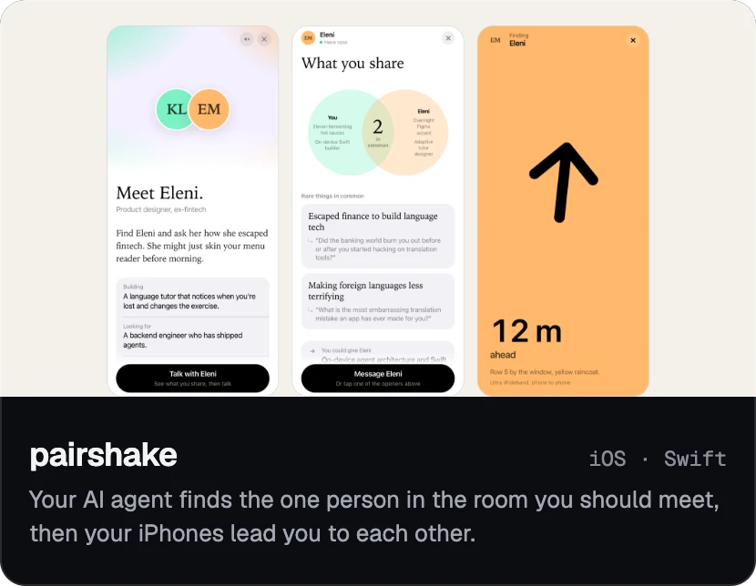
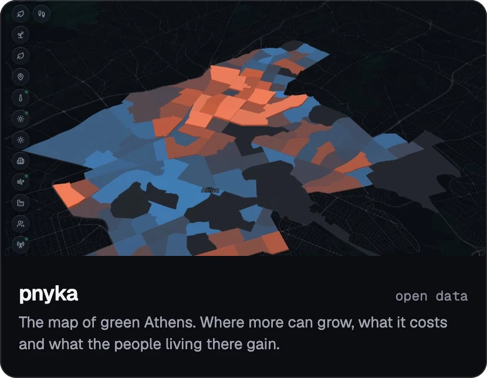
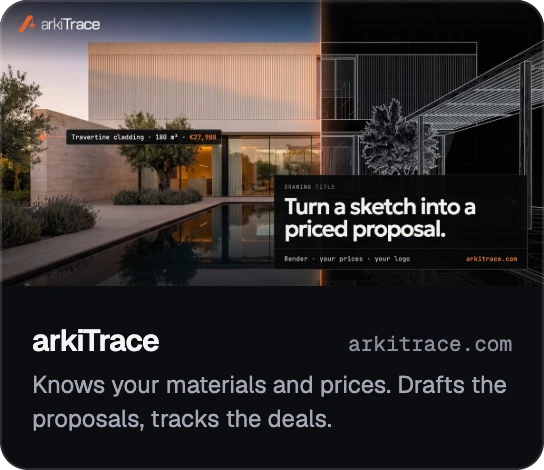
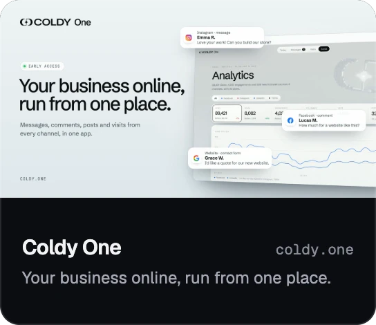
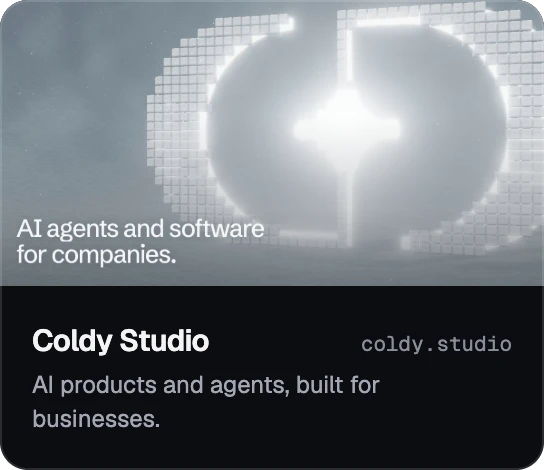
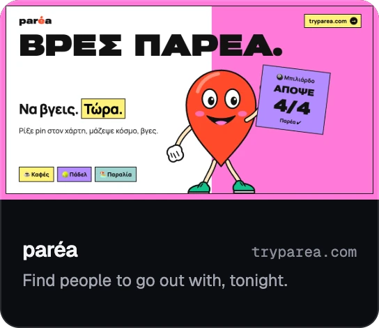
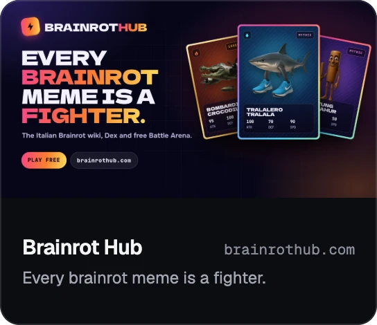

  

<h3 align="center">I'm Gregory. I'm building owan, the one AI you own.</h3>

  owan lives on your Mac and grows with you, learning your projects, your people, 
  your decisions and the thinking behind them. The longer you work together, 
  the more it can take on for you.

  <a href="https://owan.ai"><b>owan.ai</b></a>
  &nbsp;·&nbsp;
  <a href="https://syde.one">syde.one</a>
  &nbsp;·&nbsp;
  <a href="https://x.com/sydedev">X</a>
  &nbsp;·&nbsp;
  <a href="https://www.linkedin.com/in/gregoryserd/">LinkedIn</a>
  &nbsp;·&nbsp;
  <a href="https://www.youtube.com/@sydedev">YouTube</a>

owan was called troth until November 2026.

 

### Open repos

  
  

### Also built

  
  
  

  
  

