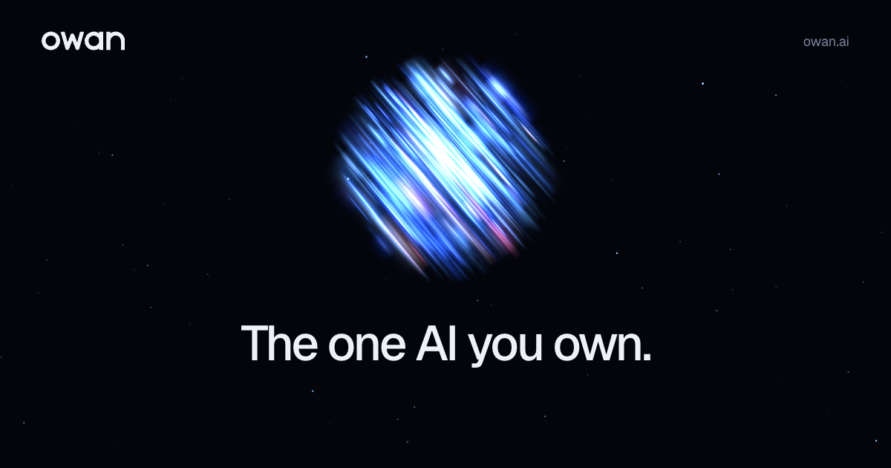

  

 

I'm Gregory, an independent builder and the founder of
**[owan](https://owan.ai)**.

owan is the one AI you own. It lives on your Mac and grows with you, learning
your projects, your people, your decisions and the thinking behind them. The
longer you work together, the more it can take on for you.

owan was called troth until November 2026. Same product, same person behind it,
new name.

## Open repos

|  |  |
|:---|:---|
| **[pairshake](https://github.com/xgre1/pairshake)** | Your AI agent talks to every other agent in the room and finds the one person you should meet right now. Then your iPhones lead you to each other. Built at the Gen AI Summit Hackathon, Athens 2026. |
| **[pnyka](https://github.com/xgre1/pnyka)** | A map of the green space of Athens. Where more can grow, what it costs and what the people living there gain. Live at [dataexplora.com/pnyka](https://dataexplora.com/pnyka). |

 

  <a href="https://owan.ai"><b>owan.ai</b></a>
  &nbsp;·&nbsp;
  <a href="https://syde.one"><b>Everything else I build</b></a>
  &nbsp;·&nbsp;
  <a href="https://x.com/sydedev">@sydedev</a>

